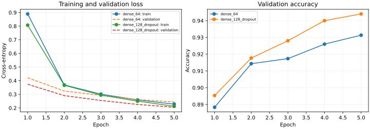
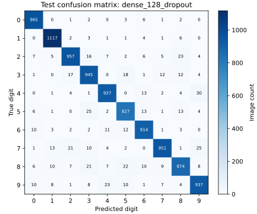

# TensorFlow handwritten digit classifier

An executed learning notebook that compares two small Keras neural networks on
MNIST and evaluates the selected model on held-out test images.

[Open the notebook on GitHub](mnist_classifier.ipynb) ·
[Run in Google Colab](https://colab.research.google.com/github/Danobentey/technical-portfolio/blob/main/tensorflow-digit-classifier/mnist_classifier.ipynb)

## What it does

1. Downloads MNIST through `tf.keras.datasets.mnist.load_data()`.
2. Normalises pixels to float32 values in 0–1.
3. Uses 12,000 training images and 3,000 validation images from the original
   training partition; leaves the original 10,000 test images separate.
4. Trains a 64-unit dense baseline and a 128-unit dense model with 0.2 dropout,
   using the same seed, optimiser, batch size and five-epoch training budget.
5. Selects a model on validation accuracy, then evaluates it on the test set.
6. Saves actual metrics, training curves, a confusion matrix and example errors.

The two candidates change both hidden-layer width and dropout. This comparison
does not establish which individual change caused a difference in accuracy.

## Run

In Colab, select **Runtime → Run all**. Colab has TensorFlow available and the
notebook records the package versions it uses. A network connection is needed
for the first MNIST download. This project does not require a GPU or a paid service.

For local execution, use Python 3.12 and an activated virtual environment:

```bash
python -m pip install -r tensorflow-digit-classifier/requirements.txt
python scripts/execute_notebook.py
python scripts/check_notebook.py
```

Run those commands from the repository root. The requirements describe the pinned
CPU environment used for the committed run. The platform markers select
`tensorflow-cpu` on Linux and `tensorflow` elsewhere; use Colab if your operating
system does not support those package versions.

## Outputs

| Output | Meaning |
| --- | --- |
| `mnist_classifier.ipynb` | Code, explanations and saved execution outputs |
| `results/metrics.json` | Split sizes, environment, candidate validation metrics, final test metrics and confusion matrix |
| `results/training.svg` | Training and validation learning curves |
| `results/confusion-matrix.svg` | True labels against predicted labels |
| `results/prediction-errors.svg` | First twelve misclassified test images in dataset order |
| `results/mnist-classifier.keras` | Locally generated selected model; excluded from Git |





The committed result is one measured run, not a guaranteed accuracy target. See
[the verification report](../docs/VERIFICATION.md) for its measured values.

## Limitations

This uses a small subset of the available training data and one random seed.
Accuracy on MNIST does not establish accuracy on a different image source.
Softmax scores are not calibrated confidence estimates. A useful next experiment
is to keep the hidden-layer width fixed and change only dropout, using several
seeds while keeping the final test set separate.

Learning references: [TensorFlow beginner quickstart](https://www.tensorflow.org/tutorials/quickstart/beginner)
and [Keras MNIST documentation](https://keras.io/api/datasets/mnist/).

The notebook and execution tooling were generated with ChatGPT/Codex assistance.
